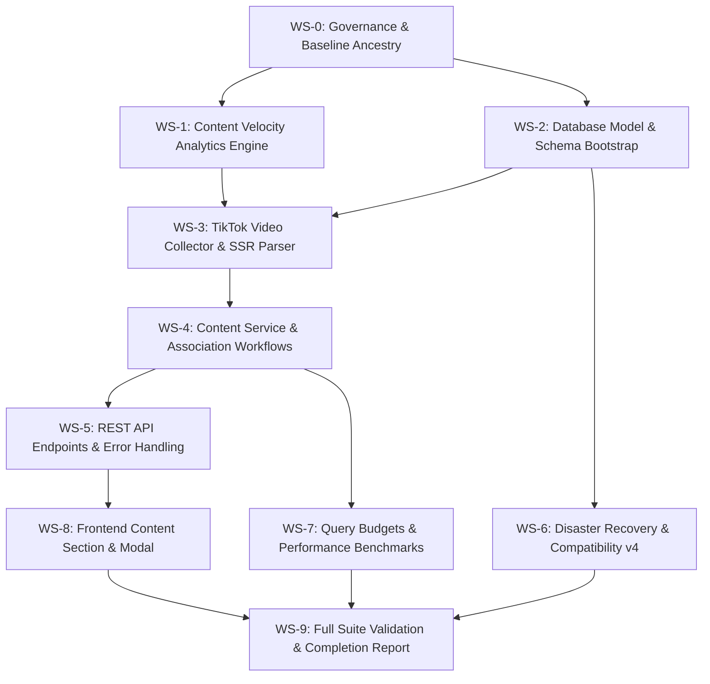

# Phase 7 — TikTok Content Intelligence & Video Signals

Status: `APPROVED`  
Roadmap Reference: `PROJECT_CONTROL_PHASE7_SELECTION.md` / `PROJECT_CONTROL_PHASE7_RESEARCH_ACCEPTED.md` / `PROJECT_CONTROL_ADR006_ACCEPTED.md` / `PROJECT_CONTROL_PHASE7_PLAN_APPROVED.md` / `docs/architecture/ADR-006.md` / `PLAN.md` / `PROJECT_STATUS.md`  
Created: `2026-10-07`  
Approved: `2026-10-07`  
Implementation Authorization: **AUTHORIZED**  
Project Control Approval: **APPROVED**  
Planning Baseline Commit: `8e36d7732a39a7751963283259687e174b88e146`  
Authoritative Selection Commit: `5beb082`  
Accepted Research Artifact: [`research/PHASE_7_CONTENT_INTELLIGENCE_RESEARCH.md`](research/PHASE_7_CONTENT_INTELLIGENCE_RESEARCH.md)  
Accepted Architecture Decision: [`docs/architecture/ADR-006.md`](docs/architecture/ADR-006.md)  
Qualified Repository Release Baseline: `ed442bf3c9bfaabaef01c054d2df9e9771c47bc2`  
Qualified Product-Code Baseline: `2f3e4b4783307bdfa5e5ffbc7cfd49576572eb0f`  

Current Implemented Portable Backup Compatibility: `"3"`  
Phase 7 Target Compatibility After Schema Implementation: `"4"`  

---

## 1. Objective

Phase 7 introduces content intelligence and video engagement signals into the product decision workspace:

```text
track → analyze → explain → monitor → alert → export → organize → review → compare → model economics → TRACK CONTENT SIGNALS → decide
```

The phase objective is defined strictly and narrowly:

> **Allow an operator to discover, link, track, and measure TikTok video and creator engagement momentum associated with a tracked Product, providing transparent content velocity signals without altering the core product Trend Score or attempting fragile video media downloading.**

The workflow specifically answers:
> *“Is this product gaining creator momentum and viral video reach on TikTok, and how fast are views and engagement growing over the last 24 hours?”*

### 1.1 What Phase 7 Does NOT Promise
- Phase 7 does **NOT** promise or attempt automatic unguided hashtag/search scraping without CAPTCHA solvers.
- Phase 7 does **NOT** promise video downloading, audio processing, or local video file storage.
- Phase 7 does **NOT** claim that video views represent creator sales or affiliate payouts.

---

## 2. Context & Current State

### 2.1 Project Control State Supplied for this Plan
- **Phase 1–6 Status:** `COMPLETE / ACCEPTED`.
- **Phase 6 Source-Release Qualification:** `READY WITH DOCUMENTED NON-BLOCKING ISSUES` for the supported **Windows / local / source-based runtime** (qualified repository revision `ed442bf3c9bfaabaef01c054d2df9e9771c47bc2`, qualified product-code revision `2f3e4b4783307bdfa5e5ffbc7cfd49576572eb0f`).
- **Phase 7 Status:** `SELECTED / RESEARCH COMPLETE / ARCHITECTURE ACCEPTED`.
- **Research Gate:** `CLOSED / ACCEPTED` ([`research/PHASE_7_CONTENT_INTELLIGENCE_RESEARCH.md`](research/PHASE_7_CONTENT_INTELLIGENCE_RESEARCH.md)).
- **Architecture Gate:** `CLOSED / ACCEPTED` ([`docs/architecture/ADR-006.md`](docs/architecture/ADR-006.md)).
- **ADR-006 Acceptance Record:** [`PROJECT_CONTROL_ADR006_ACCEPTED.md`](PROJECT_CONTROL_ADR006_ACCEPTED.md).
- **Implementation Authorization:** **NOT AUTHORIZED**.

### 2.2 Existing Behavior that Remains Authoritative
Phase 7 builds strictly upon established system boundaries:
1. **Phase 2 Trend Analytics:** Preserves deterministic Trend Score, orthogonal evidence confidence, Why Trending explanations, null preservation, and quarantine exclusion. Content velocity metrics must never alter Trend Score.
2. **Phase 3 Watchlist & Alerts:** `WatchlistItem` remains the sole scheduled-refresh authority. Alert evaluation remains post-commit, product-scoped, and governed by ADR-003.
3. **Phase 4 Disaster Recovery:** Same-version restore policy (ADR-004), offline launcher-owned restore (`RESTORE.bat`), candidate file pre-validation, pre-restore safety backups, and host-bound session isolation remain unchanged.
4. **Phase 5 Opportunity Workspace:** Collections remain purely for decision organization. Compare remains transient (2–5 products) and read-only.
5. **Phase 6 Affiliate Economics:** Economics scenarios remain VND-only, manual-first, and governed by ADR-005.
6. **Runtime Boundary:** Supported runtime remains Windows / local / source-based runtime. Standalone executable packaging remains deferred.

---

## 3. Research Conclusions & Architecture Decisions

This plan is strictly constrained by the accepted conclusions of [`research/PHASE_7_CONTENT_INTELLIGENCE_RESEARCH.md`](research/PHASE_7_CONTENT_INTELLIGENCE_RESEARCH.md) and the binding invariants of [`docs/architecture/ADR-006.md`](docs/architecture/ADR-006.md):

1. **Domain Separation:** Market Evidence (Phases 1–3), User Economics Assumptions (Phase 6), and Content Intelligence (Phase 7) must remain strictly separated.
2. **Attribution Boundary:** Video views and likes represent social engagement, not affiliate attribution.
3. **Association Modalities:** User-assisted URL input + PDP showcase link harvesting.
4. **HTTP-First SSR Extraction:** Extract video stats directly from `<script id="__UNIVERSAL_DATA_FOR_REHYDRATION__">` (or `SIGI_STATE`), with headless Playwright fallback for WAF challenges.
5. **Zero Media Binary Storage:** No video (.mp4, .webm) or audio files are downloaded or saved to disk.
6. **Lossless Integer Arithmetic & Velocity Formulas:** 24h velocity uses bounded candidate window $[20\text{h}, 28\text{h}]$, exact integer ratio round-half-up, and non-negative clamping.
7. **Two New Models:** Additive tables `product_videos` and `video_snapshots`.
8. **Disaster Recovery Compatibility `"3" → "4"`:** Adding content tables advances `portable_backup_compatibility_version` to `"4"` under ADR-004 same-version restore rules.
9. **Query Budgets (Zero N+1):** Product detail page with videos executes $\le 3$ SQL queries. Zero HTTP fanout.

---

## 4. Authoritative Acceptance Criteria

### Workstream 1: Content Velocity Engine & Mathematical Modeling
- **`P7-AC-01` [Score Independence]:** Content metrics must never alter, weigh into, or contaminate the Phase 2 `Trend Score`, trend confidence, trend state, or Why Trending explanations.
- **`P7-AC-02` [Attribution Transparency]:** Views, likes, and engagement velocity must be presented with clear disclaimers that content signals do not represent creator sales volume or guaranteed affiliate revenue.
- **`P7-AC-03` [Zero Media Binary Storage]:** No video binary files (.mp4, .webm) or raw audio streams are stored or cached locally. Only metadata, metrics, and public HTTPS image thumbnail URLs are persisted.
- **`P7-AC-04` [24h Views Velocity Calculation]:** When a video has observations across a candidate window of $[20\text{h}, 28\text{h}]$, views velocity must be calculated as $\Delta \text{views} / \Delta t_{\text{days}}$ with exact elapsed time semantics.
- **`P7-AC-05` [24h Likes Velocity Calculation]:** Likes velocity must be calculated as $\Delta \text{likes} / \Delta t_{\text{days}}$ over the same candidate window.
- **`P7-AC-06` [Engagement Metrics]:** Total engagement $E = \text{likes} + \text{comments} + \text{shares} + \text{collects}$, engagement velocity $V_E = \Delta E / \Delta t_{\text{days}}$, and engagement rate $E / \text{views}$ must be deterministically calculated.
- **`P7-AC-07` [Null Preservation]:** When a video has $< 20\text{h}$ of history, all velocity metrics must evaluate strictly to `null`. Missing metrics must never be falsified as `0`.
- **`P7-AC-08` [Non-Negative Clamping & Anomaly Flagging]:** If platform metric adjustments cause $\Delta < 0$, velocity must clamp to $0$ and set `anomaly_detected = True`.
- **`P7-AC-09` [Rational Rounding Authority]:** Integer displays must use exact integer ratio round-half-up $(2N + D) // (2D)$ without floating-point representation drift.

### Workstream 2: Persistent Data Models & Concurrency
- **`P7-AC-10` [Model Definition: `ProductVideo`]:** Additive table `product_videos` must persist `id`, `product_id`, `video_id`, `video_url`, `creator_handle`, `creator_nickname`, `creator_avatar_url`, `description`, `thumbnail_url`, `published_at`, `source_type`, `created_at`, `updated_at`.
- **`P7-AC-11` [Model Definition: `VideoSnapshot`]:** Additive table `video_snapshots` must persist `id`, `video_id`, `play_count`, `digg_count`, `comment_count`, `share_count`, `collect_count`, `captured_at`, `source_channel`, `is_available`.
- **`P7-AC-12` [Unique Constraint & Indexing]:** `product_videos` must enforce `UNIQUE(product_id, video_id)`, with indexing on `product_id` and `video_id`.
- **`P7-AC-13` [Snapshot Composite Index]:** `video_snapshots` must define composite index `ix_video_snapshots_video_captured (video_id, captured_at DESC)`.
- **`P7-AC-14` [Foreign Key Cascades]:** Deleting a Product cascades cleanly to delete associated `product_videos` and `video_snapshots`.
- **`P7-AC-15` [Additive Schema Bootstrap]:** Schema bootstrap executes via `Base.metadata.create_all()` without Alembic migrations, leaving existing tables intact.

### Workstream 3: Video Collection & Extraction Engine
- **`P7-AC-16` [URL Validation & Canonicalization]:** System must validate TikTok video URLs matching `^https?://(?:www\.)?tiktok\.com/@([a-zA-Z0-9_.-]+)/video/(\d+)` and reject invalid formats with structured 422 errors.
- **`P7-AC-17` [HTTP-First SSR Extraction]:** Collector extracts metadata from `<script id="__UNIVERSAL_DATA_FOR_REHYDRATION__">` (or `SIGI_STATE`) with browser headers.
- **`P7-AC-18` [Playwright Fallback]:** Collector falls back to headless Playwright session reuse if WAF challenges or JavaScript-only rendering occur.
- **`P7-AC-19` [Unavailable Video Handling]:** If a video is removed or marked private, the snapshot records `is_available = False` without deleting historical records.
- **`P7-AC-20` [PDP Showcase Video Harvesting]:** When crawling a TikTok Shop PDP, collector harvests creator showcase video URLs and automatically attaches them to the Product.
- **`P7-AC-21` [On-Demand & Scheduled Refresh]:** System supports both on-demand single video refresh and batch refresh of all videos associated with watched products.

### Workstream 4: REST API Endpoints & Contract
- **`P7-AC-22` [List Product Videos API]:** `GET /api/products/{id}/videos` returns associated videos with latest snapshot, metrics, and velocity.
- **`P7-AC-23` [Add Video API]:** `POST /api/products/{id}/videos` accepts `{video_url}` and returns created `ProductVideo` with initial snapshot.
- **`P7-AC-24` [Duplicate Video Rejection]:** Attempting to add an already associated video returns structured 409 Conflict.
- **`P7-AC-25` [Remove Video API]:** `DELETE /api/products/{id}/videos/{video_id}` detaches the video from the product cleanly.
- **`P7-AC-26` [Refresh Video API]:** `POST /api/products/{id}/videos/{video_id}/refresh` triggers on-demand metrics capture.
- **`P7-AC-27` [Quarantine Protection]:** Operations on quarantined legacy products are rejected with structured 404 or 422 errors.

### Workstream 5: Disaster Recovery & Backup Compatibility
- **`P7-AC-28` [Compatibility Marker Advance `"3" → "4"`]:** Schema initialization advances `portable_backup_compatibility_version = "4"` in `system_metadata`.
- **`P7-AC-29` [Legacy Backup Rejection]:** Restoring a `v1`, `v2`, or `v3` backup into a `v4` runtime is deterministically rejected with structured HTTP 400.
- **`P7-AC-30` [Version 4 Online Backup]:** `BACKUP.bat` produces valid `tinix-affiliate-v4-*.sqlite3` online backups containing video tables.
- **`P7-AC-31` [Host-Bound Session Isolation]:** Session files (`tiktok-session.json`) remain strictly excluded from all backups and exports.

### Workstream 6: Performance & Query Budgets
- **`P7-AC-32` [Product Detail Query Budget]:** Fetching Product Detail with videos executes $\le 3$ SQL queries.
- **`P7-AC-33` [Zero N+1 Query Invariant]:** Video list and comparison queries must not execute N+1 database queries.
- **`P7-AC-34` [Representative Benchmark Gate]:** On a 200-product / 1,000-video / 10,000-snapshot synthetic dataset, detail rendering executes in $< 20\text{ms}$ (hard gate: $< 200\text{ms}$).

### Workstream 7: Frontend Workspace & User Experience
- **`P7-AC-35` [Product Videos Section]:** Dedicated UI section on Product Detail page displaying associated videos in a responsive card layout.
- **`P7-AC-36` [Velocity Badges & Metrics]:** Badges for 24h views velocity, likes velocity, and engagement rate.
- **`P7-AC-37` [Add Video Modal]:** Operator modal with URL input, real-time validation, and progress indicator.
- **`P7-AC-38` [Transparency Disclaimer]:** Prominent disclaimer banner clarifying that video metrics reflect social reach, not direct creator payout.
- **`P7-AC-39` [Empty & Loading States]:** Clear empty states when no videos are linked and loading spinners during on-demand refresh.

---

## 5. Workstream Breakdown & Implementation Sequence



- **WS-0: Governance, Baseline Ancestry & Working Tree Verification**
  - Verify clean working tree, HEAD commit ancestry, and unchanged Phase 6 baselines.
- **WS-1: Content Velocity Analytics Engine (`backend/app/analytics/content_velocity.py`)**
  - Implement pure calculation engine: $V_{\text{views}}$, $V_{\text{likes}}$, $V_{\text{engagement}}$, candidate window bounding, null-safety, integer ratio rounding.
- **WS-2: Database Models & Additive Bootstrap (`backend/app/models/content.py`)**
  - Create `ProductVideo` and `VideoSnapshot` SQLAlchemy models with unique constraints and composite indices.
  - Implement additive bootstrap logic and dynamic metadata derivation.
- **WS-3: TikTok Video Collector & SSR Parser (`backend/app/collectors/tiktok_video/`)**
  - Build HTTP-first SSR extractor for `__UNIVERSAL_DATA_FOR_REHYDRATION__` and `SIGI_STATE`.
  - Integrate Playwright fallback for WAF challenges.
- **WS-4: Content Service & Association Workflows (`backend/app/services/content_service.py`)**
  - Implement video association, URL normalization, deduplication, on-demand refresh, and PDP harvesting.
- **WS-5: REST API Endpoints (`backend/app/api/videos.py`)**
  - Expose `GET /api/products/{id}/videos`, `POST /api/products/{id}/videos`, `DELETE /api/products/{id}/videos/{video_id}`, `POST /api/products/{id}/videos/{video_id}/refresh`.
- **WS-6: Disaster Recovery & Backup Compatibility Version `"4"`**
  - Advance `portable_backup_compatibility_version = "4"` in `system_metadata`.
  - Update candidate restore validator to reject v1–v3 backups.
  - Verify `BACKUP.bat` produces v4 backups.
- **WS-7: Query Budgets & Performance Benchmarks**
  - Write focused query budget tests and 200-product / 1,000-video / 10,000-snapshot benchmark test.
- **WS-8: Frontend Workspace Components (`ProductVideosSection.tsx`, `AddVideoModal.tsx`)**
  - Implement video cards, velocity badges, add modal, refresh button, and commercial disclaimer banner.
- **WS-9: Full Suite Validation & Completion Report**
  - Run full backend pytest, frontend Vitest, TypeScript typecheck, ESLint, Next.js build, healthcheck, and author completion report.

---

## 6. Test & Validation Matrix

| Test Domain | Target Suite | Key Invariants Tested |
| :--- | :--- | :--- |
| **Pure Analytics Engine** | `test_content_velocity.py` | 24h window bounding $[20\text{h}, 28\text{h}]$, null-safety, clamping, exact integer ratio rounding |
| **Model & Bootstrap** | `test_content_models.py` | Unique constraint, composite indices, foreign key cascades, additive bootstrap |
| **Video Collector & SSR** | `test_video_collector.py` | Script tag regex extraction, JSON navigation, Playwright fallback, unavailable handling |
| **Content Service & API** | `test_content_api.py` | Add/list/delete/refresh endpoints, 409 duplicate rejection, 422 URL validation, quarantine protection |
| **Disaster Recovery** | `test_backup_v4.py` | v1-v3 rejection, v4 round-trip, manifest guard, credential isolation |
| **Query Budgets & Latency** | `test_performance_and_queries.py` | $\le 3$ SQL queries on detail, Zero N+1, sub-20ms benchmark latency |
| **Frontend UI Integration** | `phase7-content.test.tsx` | Video cards rendering, Add Video modal submission, velocity badge displays, disclaimer banner |

---

## 7. Plan Status & Authorization

- **Plan Status:** `APPROVED`
- **Implementation Status:** **AUTHORIZED**
- **Approval Record:** [`PROJECT_CONTROL_PHASE7_PLAN_APPROVED.md`](PROJECT_CONTROL_PHASE7_PLAN_APPROVED.md)
- **Next Step:** Proceed to Workstream WS-0 through WS-9 execution under `PHASE IMPLEMENTATION`.
